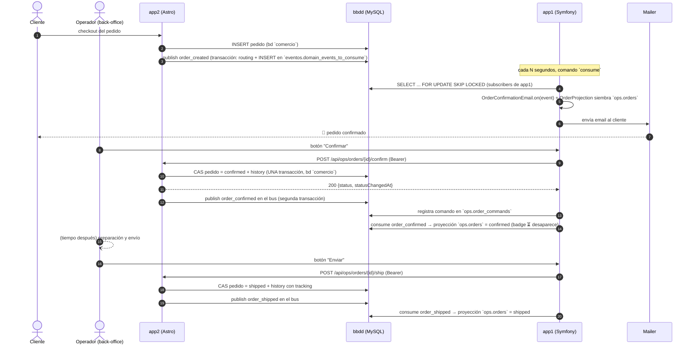

# 02 · Escenario de la demo: e-commerce

## Premisa

Una mini-tienda donde **la web (app2)** vende y **el back-office (app1)** procesa. La comunicación tiene dos vías:

- **Eventos de dominio** persistidos en la cola de MySQL (checkout, vistas, cambios de estado, catálogo) — ninguna app comparte código ni BD de dominio con la otra.
- **Un comando síncrono HTTP** app1 → app2 para confirmar/enviar pedidos (app2 es dueña del estado del pedido y responde en el momento; docs/05).

## Roles por aplicación

| App | Stack | Contexto acotado | Como publicador | Como consumidor | Estado de dominio |
|-----|-------|------------------|-----------------|-----------------|-------------------|
| **app2** | Node 26 + Astro (SSR con API routes) | `commerce` (tienda) | `order_created`, `product_viewed`, `order_confirmed`, `order_shipped` | `ops.product_created`, `ops.product_updated` | `comercio.orders` + `order_status_history` (la máquina de estados vive aquí) y `comercio.products` (proyección del catálogo) |
| **app1** | PHP 8.3 + Symfony | `ops` (operaciones) | `product_created`, `product_updated` (del catálogo) | `order_created`, `order_confirmed`, `order_shipped`, `product_viewed` | `ops.products` (fuente del catálogo + métrica `views`), `ops.orders` (proyección de pedidos) y `ops.order_commands` (auditoría de comandos) |

## Eventos del escenario

| Evento (`name`) | Publicador | Suscriptores | Efecto |
|-----------------|------------|--------------|--------|
| `commerce.order_created_domain_event` | app2 | app1: `OrderConfirmationEmail` + `OrderProjection` | Email al cliente + siembra de la proyección `ops.orders` |
| `commerce.product_viewed_domain_event` | app2 | app1: `ProductStats` | Incrementa el contador `views` del producto en `ops.products` |
| `ops.order_confirmed_domain_event` | app2 | app1: `OrderProjection` | La proyección `ops.orders` pasa a `confirmed` |
| `ops.order_shipped_domain_event` | app2 | app1: `OrderProjection` | La proyección `ops.orders` pasa a `shipped` (+ `tracking_number`) |
| `ops.product_created_domain_event` / `ops.product_updated_domain_event` | app1 | app2: `SyncProductCatalog` | Upsert de la proyección `comercio.products` |

> La convención de naming (incluido por qué `domain_event` en el nombre) y el payload exacto de cada evento están en [04-modelo-eventos.md](04-modelo-eventos.md#convención-de-naming).

## Flujo 1 · Pedido creado → confirmado → enviado



## Flujo 2 · Catálogo → tienda y vista de producto → métricas

1. El operador crea/edita un producto en el back-office de app1 (fuente del catálogo, bd `ops`) → app1 publica `ops.product_created` / `ops.product_updated`.
2. En su siguiente ronda de consumo, app2 ejecuta `SyncProductCatalog`: upsert de la proyección `comercio.products` con guard por fechas.
3. El cliente navega un producto en app2 → app2 registra la vista y **publica `product_viewed`**.
4. En su siguiente ronda de consumo, app1 ejecuta el suscriptor `ProductStats`: `UPDATE ops.products SET views = views + 1`.
   *(Análogo al caso de la referencia de Codely, donde las vistas de producto se contabilizan cruzando contextos `mooc` → `shop`.)*

## Qué demuestra cada pieza del escenario

| Pieza del escenario | Qué demuestra |
|---------------------|---------------|
| Checkout en app2 guarda el pedido y después publica el evento (dos pasos como la referencia: el bus abre su propia transacción en `eventos`, ver [05-flujo-publicacion.md](05-flujo-publicacion.md)) | El evento no existe si el negocio no se completó; si el `publish` falla tras el save lo reintenta el bus (3×30ms). Transacción única dominio+cola (outbox real): mejora futura |
| app1 recibe el evento segundos después vía cron | **Desacoplamiento temporal**: las apps no se conocen para los hechos de dominio |
| Confirmar/Enviar via comando síncrono HTTP (404/409 en la respuesta) | Coordinación **por adjacencia** cuando hay que decidir en el momento: evento para los hechos ya ocurridos, comando para lo que necesita verificación ya |
| app2 publica `order_confirmed`/`order_shipped` tras aceptar el comando | Comunicación **bidireccional** con una sola dirección de propiedad: app2 es dueña del estado, app1 lo proyecta |
| `ops.order_commands` + badge de pendientes propio de app1 (nunca consulta la cola) | El **indicador de progreso** se calcula con datos locales (comando emitido vs retén de la proyección) — funciona igual con cualquier transporte |
| `product_viewed` produce una escritura en la BD de dominio de app1 | Consumidores con **efectos de lectura/escritura sostenibles**, no solo emails falsos |
| Un suscriptor que falla pasa por `retries` y acaba en dead letter | Tolerancia a fallos sin perder eventos (ver [06-flujo-consumo.md](06-flujo-consumo.md)) |

## Bases de datos de dominio

`comercio`, dueño repartido: app2 (`orders`, `order_items`, `order_status_history` y la proyección `products`), app1 nada. `ops`, dueño app1: `products` (fuente del catálogo + `views`), `orders` (proyección) y `order_commands` (auditoría de comandos). DDL completo en `databases/02-comercio.sql` y `databases/03-ops.sql`.

### `comercio` (app2)

```sql
CREATE TABLE orders (
    id CHAR(36) PRIMARY KEY NOT NULL,
    email VARCHAR(255) NOT NULL,
    total_amount DECIMAL(10, 2) NOT NULL,
    total_currency CHAR(3) NOT NULL,
    status ENUM('created', 'confirmed', 'shipped') NOT NULL DEFAULT 'created',
    created_at TIMESTAMP NOT NULL
);

CREATE TABLE order_items (
    id CHAR(36) PRIMARY KEY NOT NULL,
    order_id CHAR(36) NOT NULL,
    product_id CHAR(36) NOT NULL,
    quantity INT NOT NULL,
    INDEX idx__order_items__order_id (order_id)
);

-- Proyección del catálogo (fuente: ops.products de app1, docs/05):
-- sólo siembra/aplica eventos con `changed_at` posterior al de la fila.
CREATE TABLE products (
    id CHAR(36) PRIMARY KEY NOT NULL,
    name VARCHAR(255) NOT NULL,
    price_amount DECIMAL(10, 2) NOT NULL,
    price_currency CHAR(3) NOT NULL,
    changed_at TIMESTAMP(6) NOT NULL
);

CREATE TABLE order_status_history (
    id CHAR(36) PRIMARY KEY NOT NULL,
    order_id CHAR(36) NOT NULL,
    status VARCHAR(50) NOT NULL,
    tracking_number VARCHAR(255) NULL,   -- nº seguimiento, sólo en la fila de `shipped`
    changed_at TIMESTAMP(6) NOT NULL,
    INDEX idx__order_status_history__order_id (order_id)
);
```

### `ops` (app1, remodelado)

```sql
-- Fuente del catálogo: el back-office la crea/edita y publica product_*.
-- `views` es la métrica del Consuming de app1 (Actualizar las views).
CREATE TABLE products (
    id CHAR(36) PRIMARY KEY NOT NULL,
    name VARCHAR(255) NOT NULL,
    price_amount DECIMAL(10, 2) NOT NULL,
    price_currency CHAR(3) NOT NULL,
    views INT NOT NULL DEFAULT 0,
    changed_at TIMESTAMP(6) NOT NULL
);

-- Proyección de pedidos agregada por app1 (el estado vive en `comercio.orders`).
CREATE TABLE orders (
    id CHAR(36) PRIMARY KEY NOT NULL,
    email VARCHAR(255) NOT NULL,
    total_amount DECIMAL(10, 2) NOT NULL,
    total_currency CHAR(3) NOT NULL,
    status ENUM('created', 'confirmed', 'shipped') NOT NULL,
    created_at TIMESTAMP(6) NOT NULL,
    status_changed_at TIMESTAMP(6) NULL      -- retén del último cambio aplicado
);

-- Auditoría de comandos aceptados (confirm/ship): perisistente forever.
-- El badge "pendiente" compara `requested_at` de la última fila con
-- `orders.status_changed_at` de la proyección (docs/05).
CREATE TABLE order_commands (
    id CHAR(36) PRIMARY KEY NOT NULL,
    order_id CHAR(36) NOT NULL,
    action ENUM('confirm', 'ship') NOT NULL,
    requested_status ENUM('confirmed', 'shipped') NOT NULL,
    requested_at TIMESTAMP(6) NOT NULL,
    INDEX idx__order_commands__order_id (order_id)
);
```
