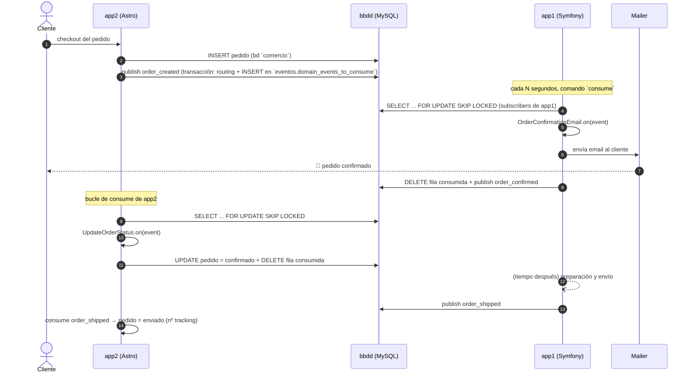

# 02 · Escenario de la demo: e-commerce

## Premisa

Una mini-tienda donde **la web (app2)** vende y **el back-office (app1)** procesa. Ambas se comunican **únicamente** mediante eventos de dominio persistidos en la cola de MySQL: ninguna app llama a la otra por HTTP ni comparten código.

## Roles por aplicación

| App | Stack | Contexto acotado | Como publicador | Como consumidor |
|-----|-------|------------------|-----------------|-----------------|
| **app2** | Node 26 + Astro (SSR con API routes) | `commerce` (tienda) | `order_created`, `product_viewed` | `order_confirmed`, `order_shipped` |
| **app1** | PHP 8.3 + Symfony | `ops` (operaciones) | `order_confirmed`, `order_shipped` | `order_created`, `product_viewed` |

## Eventos del escenario

| Evento (`name`) | Publicador | Suscriptores | Efecto |
|-----------------|------------|--------------|--------|
| `commerce.order_created_domain_event` | app2 | app1: `OrderConfirmationEmail` | Manda email de confirmación al cliente |
| `commerce.product_viewed_domain_event` | app2 | app1: `ProductStats` | Incrementa el contador `views` del producto |
| `ops.order_confirmed_domain_event` | app1 | app2: `UpdateOrderStatus` | Marca el pedido como confirmado (visible en la web) |
| `ops.order_shipped_domain_event` | app1 | app2: `UpdateOrderStatus` | Marca el pedido como enviado, con nº de seguimiento |

> La convención de naming (incluido por qué `domain_event` en el nombre) y el payload exacto de cada evento están en [04-modelo-eventos.md](04-modelo-eventos.md#convención-de-naming).

## Flujo 1 · Pedido creado → confirmado → enviado



## Flujo 2 · Vista de producto → métricas

1. El cliente navega un producto en app2 → app2 registra la vista en `comercio` y **publica `product_viewed`**.
2. En su siguiente ronda de consumo, app1 ejecuta el suscriptor `ProductStats`: `UPDATE comercio.products SET views = views + 1`.
   *(Análogo al caso de la referencia de Codely, donde las vistas de producto se contabilizan cruzando contextos `mooc` → `shop`.)*

## Qué demuestra cada pieza del escenario

| Pieza del escenario | Qué demuestra |
|---------------------|---------------|
| Checkout en app2 publica en la misma transacción que guarda el pedido | Patrón **outbox**: el evento no existe si el negocio no se completó |
| app1 recibe el evento segundos después vía cron | **Desacoplamiento temporal**: las apps no se conocen |
| app1 responde publicando `order_confirmed` | Comunicación **bidireccional**: ambas apps son publicadora y consumidora |
| `product_viewed` produce una escritura en la BD de dominio de app1 | Consumidores con **efectos de lectura/escritura sostenibles**, no solo emails falsos |
| Un suscriptor que falla pasa por `retries` y acaba en dead letter | Tolerancia a fallos sin perder eventos (ver [06-flujo-consumo.md](06-flujo-consumo.md)) |

## Base de datos de dominio `comercio`

Tablas iniciales (una sola BD para la demo; cada app es dueña de las suyas):

```sql
CREATE TABLE orders (
    id CHAR(36) PRIMARY KEY NOT NULL,
    email VARCHAR(255) NOT NULL,
    total_amount DECIMAL(10, 2) NOT NULL,
    total_currency CHAR(3) NOT NULL,
    status ENUM('created', 'confirmed', 'shipped') NOT NULL DEFAULT 'created',
    created_at TIMESTAMP NOT NULL
);

CREATE TABLE order_items (
    id CHAR(36) PRIMARY KEY NOT NULL,
    order_id CHAR(36) NOT NULL,
    product_id CHAR(36) NOT NULL,
    quantity INT NOT NULL
);

CREATE TABLE products (
    id CHAR(36) PRIMARY KEY NOT NULL,
    name VARCHAR(255) NOT NULL,
    price_amount DECIMAL(10, 2) NOT NULL,
    price_currency CHAR(3) NOT NULL,
    views INT NOT NULL DEFAULT 0
);

CREATE TABLE order_status_history (
    id CHAR(36) PRIMARY KEY NOT NULL,
    order_id CHAR(36) NOT NULL,
    status VARCHAR(50) NOT NULL,
    changed_at TIMESTAMP NOT NULL
);
```
